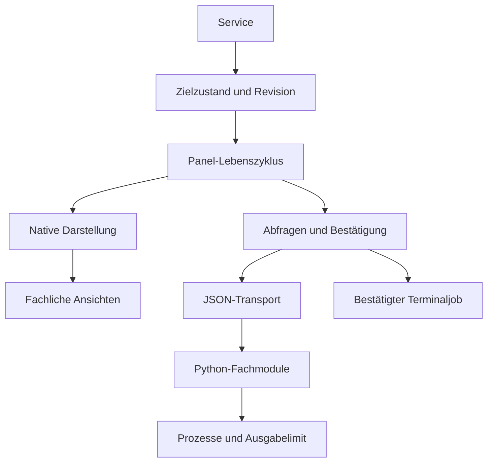

# Architektur- und Optimierungsprüfung

Stand: 2026-10-12, Entwicklungsversion 0.1.0 auf `main`.

Die Produktionsmodule, Tests, Nix-Module, Installation und Workflows wurden geprüft.
Es gibt 31 Python-/Luau-Produktionsmodule. Das größte hat 135 Zeilen; die vereinbarte
Grenze bleibt 250 Zeilen. Kleine fachliche Module wurden beibehalten.

| Bereich | Änderung | Zweck |
|---|---|---|
| Panel | Einstieg 33 Zeilen, separater Controller und Layout | Lebenszyklus, Interaktion und Darstellung getrennt |
| Anfragen | Eigene Anfragefolge je Abfrage und Aktionsplanung | Verlauf, Log und Planung verwerfen sich nicht gegenseitig |
| Konfigurationswechsel | Revisionsprüfung zusätzlich zur Ziel-ID | Alte Antworten gelten auch bei unveränderter ID nicht weiter |
| Panel schließen | Unbestätigte Pläne und ausstehende Antworten verwerfen | Keine alte Bestätigung nach erneutem Öffnen |
| Service | Zeitstempel und Zusammenfassen laufender Abfragen | Verzögerte Ticks verursachen keine falschen Intervalle |
| Generationen | Erst filtern, dann 100 Treffer begrenzen | Auch ältere Generationen bleiben auffindbar |
| Vergleich | Auswahl durch Generationsnummer statt Listenposition | Neue Generationen verschieben keine Auswahl |
| Prozessausgabe | Gleichzeitiges Lesen beider Pipes, Limit während der Ausführung | Kein unbeschränktes temporäres Ausgabefile, kein stderr-Deadlock |
| Identitätsprüfung | Profil-Symlinks einmal je Snapshot auflösen | Weniger wiederholte Dateisystemzugriffe und konsistente Markierungen |
| Metadaten | Begrenztes Lesen von .envrc und Allow-Dateien | Keine vollständigen großen Dateien vor nachträglichem Abschneiden |
| JSON-Konfiguration | Typen vor Mengenprüfungen validieren | Verständliche Fehler statt TypeError/AttributeError |
| Checkout-Skripte | Ausführbare Git-Dateimodi | Direkter Aufruf von Launcher und Installer funktioniert |

Die 18 persönlichen Output-Zuordnungen, mehrere Flakes, native Farbrollen und
bestehende Aktionsschutzprüfungen bleiben durch die Tests abgedeckt. `master`
bleibt unverändert upstream; diese Prüfung erzeugt keinen stabilen Release.

Lokal bestehen 45 Tests, einschließlich verzögerter UI-Antworten, überlappender
Anfragen, älterer Suchtreffer, stabiler Vergleichsauswahl, Ausgabelimits während
laufender Prozesse und echter /dev/tty-Eingabe. Python-Kompilierung, Installer-
Bash-Syntax und `git diff --check` bestehen. Nix und native Noctalia sind lokal
nicht installiert. Aktuelle CI-Ergebnisse stehen in [TESTS](../.ai/TESTS.md).
Die früheren vollständigen CI-Läufe 38217124145 und 38218204416 sind erfolgreich,
einschließlich nativen Noctalia-Lints.

Weitere konkrete Prüfungen vor Stable: echte UI auf nyx/aether, Skalierung und
Themes, kontrolliertes Build/Switch, Standalone Home Manager und Profil-Aliasse.
Cache-/Log-Retention, stärkere Prozessidentität im Verlauf und exakte direnv-
Trust-Metadaten sind in [TASKS](../.ai/TASKS.md) erfasst. Terminaljobs behalten
ihre steuernde TTY; das Verhalten separat weiterlaufender Kindprozesse bei
Abbruch muss auf den Hosts geprüft werden.
